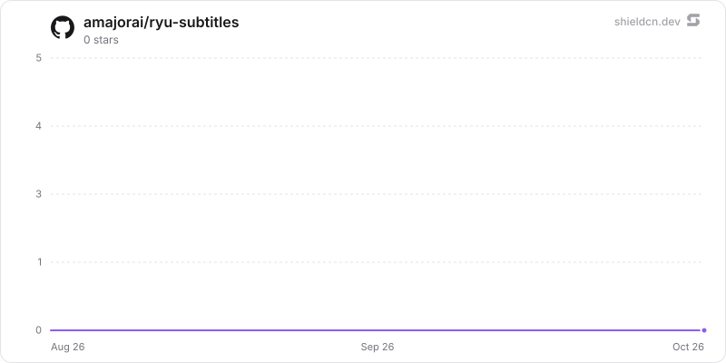

<div align="center">

# subtitles

</div>

Pick a video on your machine, transcribe it with local whisper, translate the transcript into the language you want, and write a timed .srt/.vtt beside the file. Demux and the 16 kHz downmix are pure Rust (symphonia), so there is no ffmpeg to install, and both model hops default to on-device.

> **The public home of `ryu-subtitles`.** Source, builds, and releases live here —
> binaries for every platform are attached to each release.
>
> This tree is generated from the Ryu monorepo, so commits pushed here
> directly are replaced on the next sync. **Pull requests are welcome** —
> open them here and they are ported into the monorepo, then flow back out.
> Ryu as a whole: https://github.com/amajorai/ryu

## Install

**App:** [Install](ryu://apps/com.ryu.subtitles) (opens the Ryu desktop app and asks you to confirm)

**CLI:**

```bash
ryu apps add com.ryu.subtitles
```

**From source:**

```bash
cargo build --release --manifest-path backend/Cargo.toml
```

Prebuilt binaries for every platform are attached to [each release](https://github.com/amajorai/ryu/releases).

## License

Apache-2.0 — see [LICENSE](./LICENSE).

## How it is put together

```
apps-store/subtitles/
  manifest.json        the app: companion runnable + the ryu-subtitles sidecar (port 8013)
  backend/             the sidecar — one process, no lib, ZERO dependency on apps/core
    src/media.rs       container demux → 16 kHz mono → silence-aware windows (symphonia)
    src/cues.rs        segments → subtitle cues; the SubRip / WebVTT writers
    src/translate.rs   the local-gateway translation pass
    src/engine.rs      the job worker: decode → transcribe → translate → write
    src/store.rs       SQLite jobs + node settings
    src/library.rs     the file picker's browse surface and the path gate
    src/api.rs         /api/subtitles/*
  ui/                  the companion (Vite + React, built to ONE self-contained HTML)
```

Core reaches the sidecar through the generic ext-proxy `public_mount`
(`/api/subtitles/*`); the companion reaches it through the single `subtitles.request`
bridge forwarder, because its frame runs under `connect-src 'none'` and has no network
of its own.

## Four decisions worth knowing about

**Whisper, not parakeet.** A subtitle file *is* its timings. `ryu-stt` is built at
default features so `default_stt_engine()` resolves to whisper, which returns
per-segment `start_ms`/`end_ms` from `verbose_json`. Parakeet returns text only (its
`segments` is always empty), so a parakeet job degrades to one coarse cue per window
rather than real subtitles.

**Symphonia, not ffmpeg.** There is no ffmpeg on a normal install: the only one in the
tree is `apps/shadow`'s optional `video` feature, which needs system libraries a
shipped sidecar cannot assume, and `ryu-meetings` reads WAV alone. Symphonia is pure
Rust, so the sidecar stays a single self-contained binary. A container or codec outside
its compiled feature set is reported as *"this file's container or audio codec is not
supported"* — a clear refusal, never a hang or a garbage transcript.

**The job carries a path, not the file.** The sidecar is on the same machine as the
video, so it opens it directly. Nothing is uploaded, nothing is copied, and a 4 GB film
never crosses the companion's sandbox boundary. The path is canonicalized *first* (so
`..` and symlinks resolve), then checked for containment under the user's home
directory or the node data dir, then checked against the media extension list.

**The model never sees a timecode.** Cues go out to the translator as a numbered list
of text and come back as a numbered list of text; the timings stay in Rust. Replies are
matched by index, not position, so a model that merges or splits a line loses that one
line rather than shifting every cue after it. A line that still fails keeps its original
wording, and the job reports `translated_count` below `cue_count` rather than claiming
a clean run.

## Working on it

```bash
cargo test -p ryu-subtitles              # the sidecar
bun test --cwd apps-store/subtitles/ui   # the companion's client layer
bun run --cwd apps-store/subtitles/ui build
scripts/sync-app-fixtures.sh subtitles   # rebuild + refresh the compiled-in bundle
```

Run the sidecar standalone with `RYU_SUBTITLES_PORT` (default 8013), `RYU_DIR`,
`RYU_WHISPER_URL` and `RYU_GATEWAY_URL` / `RYU_GATEWAY_TOKEN`. The translation model is
the job's model, then the model saved in the app's settings, then the bundled default.
Note that every `/api/subtitles/*` route is **fail-closed** without `RYU_EXT_TOKEN`:
Core injects that token when it spawns the sidecar, and without it the process serves
`/health` and nothing else — deliberately, because this process opens files off the
disk by path.

## At rest

`subtitles.db` seals the transcript and the job's file details per value (`encb:v1:`, store
`subtitles.db`, bound to `jobs.<column>` and the job id) under the `@ryu/subtitles` plugin subkey
Core delivers to the sidecar (`crypto:seal` in the sidecar's `host_api.grants`): `cues` (the
timed transcript and its translation), `source_path` and `source_name` (the video), `output_path`
(the copy written beside the video) and `error`. Writes seal through the `ryu_seal` SQL function
and reads open through `ryu_open` (`src/seal_sql.rs`). Status, progress, target language,
format, layout, engine, model, counts and timestamps stay plaintext: the queue and the list order
on them. Node settings hold no content and stay plaintext. The app's download renders from the
sealed cues, so no copy of a finished file is kept in the data dir; plaintext copies that earlier
versions left in `outputs/` are deleted at start. The file written beside the video is the user's
own export and is not encrypted. Legacy plaintext rows are sealed when the store opens (resumable,
idempotent), then the WAL is truncated and freed pages are zeroed (`secure_delete` is on). A job
that does not open is left out of lists and the queue and counted (`/health`
`sealing.unreadable_rows`).
Key states (`backend/src/seal_keys.rs`):

- **Compat mode**: under an older Core that delivers no key, a never-sealed store keeps working
  in plaintext and `/health` reports `sealing.state = "compat"` ("waiting for a Ryu update").
- **No key or another key for a sealed store**: `sealing.state = "unhealthy"`, writes are
  refused, the queue does not run and the data is kept.
- **Standalone** (no `RYU_PLUGIN_DATA_DIR`): `RYU_MASTER_KEY` if set, else a generated root in
  `<plugin data dir>/secrets/standalone-root.key` (0600) whose key check value is pinned.

The standalone satellite mirror builds `ryu-crypto` from crates.io at the declared version, so
the release train that ships this must publish `ryu-crypto` first (already ordered before app
backends in `tools/publish-crates.sh`).

## Star History

<a href="https://github.com/amajorai/ryu-subtitles/stargazers">
  <picture>
    <source media="(prefers-color-scheme: dark)" srcset="./.github/shieldcn/star-chart-dark.svg" />
    
  </picture>
</a>
